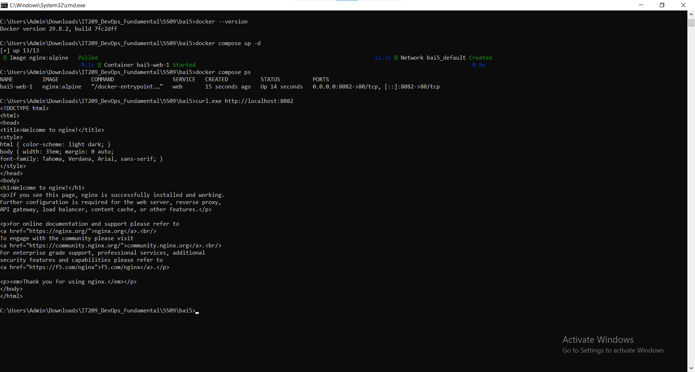
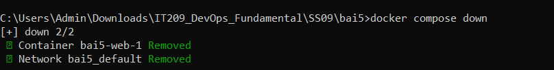

# Bài 5: Khởi chạy dịch vụ đơn giản với Docker Compose

## 1. Mục tiêu
Sử dụng Docker Compose CLI v2 để triển khai dịch vụ web Nginx.

## 2. Cấu hình Docker Compose
Tạo file `docker-compose.yml` sử dụng image `nginx:alpine` và ánh xạ cổng `8082:80`.

## 3. Thực hiện

- `docker compose up -d`: Khởi chạy dịch vụ ở chế độ nền.
- `docker compose ps`: Kiểm tra trạng thái container.
- `curl.exe http://localhost:8082`: Kiểm tra phản hồi từ máy chủ Nginx.
- `docker compose down`: Dừng và xóa container.

## 4. Kết quả

- Docker Compose khởi chạy dịch vụ Nginx.
- Container hoạt động trên cổng `8082`.
- Truy cập `http://localhost:8082` nhận được trang chào mừng Nginx.
- Dịch vụ được dừng thành công bằng lệnh `docker compose down`.

## 5. Hình ảnh minh chứng

### Ảnh 2: Kiểm tra dịch vụ
Chèn ảnh kết quả `docker compose ps` và `curl.exe http://localhost:8082`.

### Ảnh 3: Dừng dịch vụ

## 6. Kết luận
Hoàn thành triển khai, kiểm tra và dừng dịch vụ web bằng Docker Compose CLI v2.